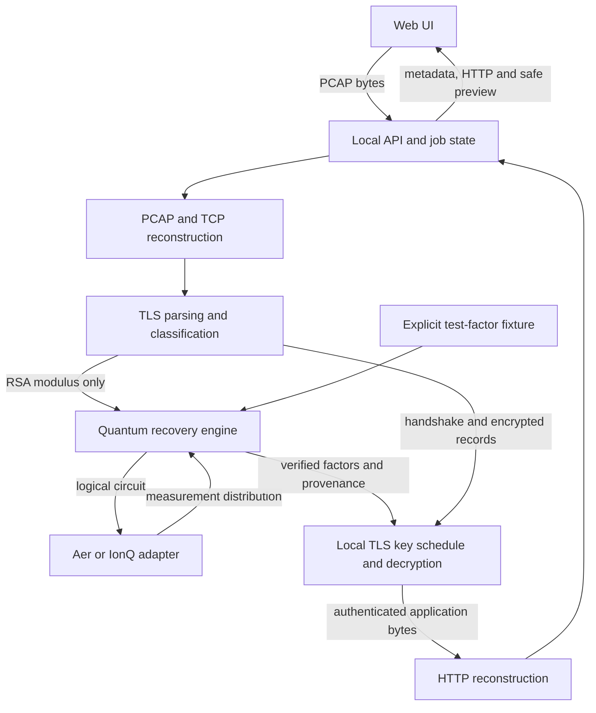

# QSploit — Definitive Implementation Specification

**Architecture decision date:** 10 October 2026
**Status:** Reviewed and reconciled with the implementation on 10 October 2026. `implementation-notes.md` records concrete adjustments; `validation.md` and `quantum-evidence.md` record checks actually run. Requirements and release gates below are not evidence that every gate has passed.
**Supersedes:** `QSploit_Teammate_Brief(1).md` and `QSploit_Engineering_Blueprint(1).md` wherever they conflict with this specification.
**Priority:** Correct genuine TLS pipeline → complete future-system demonstration → robustness and presentation → separate quantum evidence. Use minimal infrastructure throughout.

## 1. Executive summary

Build **one local Python application** that serves a small browser UI. A user uploads a PCAP, selects a TLS connection, requests recovery, and inspects authenticated HTTP plaintext when the capture and recovery result permit it.

Keep exactly three components:

| Component | Responsibility | Boundary |
|---|---|---|
| Capture and classical processing | PCAP/TCP reconstruction, TLS classification, TLS cryptography, HTTP reconstruction | Receives capture bytes and a verified recovery result; produces public metadata and authenticated application bytes |
| Quantum engine | Turn a public mathematical problem into a verified mathematical answer | Receives an RSA modulus initially; returns its factors and honest execution provenance |
| Web UI | Upload, selection, status, cryptographic details, HTTP inspection and safe preview | Uses a small same-origin HTTP API; knows nothing about packet structures or Qiskit |

**The first complete product milestone is a genuine TLS 1.2 connection using `TLS_RSA_WITH_AES_128_GCM_SHA256` (`0x009c`), RSA-2048, and HTTP/1.1, decrypted from a real packet capture using automatic modulus-matched demonstration recovery.** Support both EMS and non-EMS key schedules. Every TLS cryptographic step after factor recovery is real.

A separate demonstration runs **generic Shor order-finding circuits on small moduli**, initially 15 and 21, using Aer. IonQ submission is an optional, separately verified execution path. A simulator run is a simulation of a quantum circuit; fixture recovery is a lookup of known test factors. Neither is a hardware attack against the captured RSA-2048 connection.

Do not promise universal PCAP decryption. Discovery, theoretical vulnerability, implemented attack support, hardware feasibility, capture completeness, and successful decryption are separate facts.


### Review amendment: future workflow and demonstration timing

The application previews cryptographic recovery on future sufficiently capable cloud quantum computers. Only the missing factoring computation is substituted today. In demo mode the user uploads a PCAP and clicks the ordinary recovery action; no factor selector or second input is required. Match the exact public modulus against the isolated bundled test factors. Unknown moduli fail honestly. Never switch a failed real execution to demo mode.

`demo_delay_seconds` defaults to 3 and accepts 0 for tests. A separate `timing_for(RSAProblem, options)` function returns an explicitly illustrative presentation delay and assumptions; it must not affect factor selection or TLS processing. No credible cryptographic-scale resource estimate is available in this implementation, so do not invent one from a qubit count. A future defensible estimate may use serial depth × logical operation time × repetitions and treat qubit capacity only as a feasibility constraint. Actual provider completion always comes from provider status.

Primary acceptance requires the complete real-PCAP → demo recovery → authenticated TLS → HTTP browser workflow. Generic small-number Shor and live IonQ are separate evidence milestones and cannot block the main demonstration. Quantum code may change substantially for fault-tolerant hardware while preserving the public-problem/verified-result contract.

A single local process serves the application; a spawned recovery worker receives only a public modulus and execution options. A PCAP download route may provide the bundled public demonstration capture. Submission materials stay as repository Markdown because this assignment explicitly requests a source project with corrected Markdown specification. No external publishing or submission.

The prepared `qollab/` project is a **separate quantum companion**, using the platform-supplied backend and `main` entry point. It demonstrates measured small-number order finding and contains no capture or TLS secrets. The full capture application remains local; no arbitrary FastAPI hosting capability is assumed. Local companion tests are distinct from hosted Qollab execution. Verified submission requirements and remaining external-access steps belong in the accompanying submission materials; this build publishes or submits nothing.

## 2. Key architectural decisions

### Exact stack

| Area | Decision | Reason |
|---|---|---|
| Language | CPython 3.12, tested with 3.12.10 | One language for parsing, cryptography, API, quantum integration and tests; package metadata allows 3.12–3.13, but 3.13 is not validated here |
| Server | FastAPI, Pydantic, plain Uvicorn | Small typed API and static-file serving in one process |
| Frontend | One HTML file, one CSS file, one JavaScript ES module | This interface does not justify React, Next.js, Node, TypeScript or a build pipeline |
| PCAP and packet headers | Explicit bounded container/link/IP functions; `dpkt` TCP decoding | Keep capture length checks and stream reconstruction visible; no packet-analysis service or external runtime tool |
| Cryptographic primitives | `cryptography`; standard-library `hashlib`, `hmac`, `math` | Use vetted RSA and AES-GCM primitives; write only the TLS-specific framing and schedules |
| HTTP/1.1 | `h11` | Avoid implementing message framing, chunking, informational responses and HEAD semantics ourselves |
| HTML sanitization | `nh3` | One dependency replaces a custom HTML sanitizer; use a restrictive policy |
| Quantum circuits | `qiskit` | Circuit representation and compilation |
| Local quantum execution | `qiskit-aer`, optional `quantum` extra | Keeps the classical application usable without quantum packages |
| IonQ execution | `qiskit-ionq`, optional `ionq` extra | Provider adapter, installed only when needed |
| Tests | `pytest`, `httpx`; Python Playwright for browser acceptance | Unit, API and actual-browser verification without a frontend build system |
| Packaging | One `pyproject.toml`, one committed `uv.lock` | Reproducible dependency resolution |
| Storage | One active capture and its results in process memory | No database, user accounts, persistence service or migration layer |
| Background work | One recovery job at a time; one transient Python child process | Keeps the UI responsive and makes a local simulation deadline enforceable |

Direct runtime dependencies are therefore **seven packages**: FastAPI, Pydantic, Uvicorn, dpkt, cryptography, h11 and nh3. Qiskit packages are extras. Declare packages that our code imports directly even when another dependency also pulls them in.

Use a compatible, stable dependency set and freeze its exact versions in `uv.lock` during the initial setup gate. Do not guess release numbers from examples or install prerelease documentation versions. In particular, test Qiskit/Aer/IonQ compatibility together. That is dependency validation, not an unresolved architecture choice. No runtime downloads, CDNs or package installation.

### Deliberate scope

| Feature | First milestone |
|---|---|
| Capture containers | Classic PCAP, both byte orders and microsecond/nanosecond variants; reject PCAPNG with an explicit explanation |
| Link layers | Ethernet, including ordinary VLAN encapsulation, and BSD loopback/NULL; other link types are reported unsupported |
| Network | Unfragmented IPv4 and IPv6 TCP; recognize and report IP fragmentation rather than silently losing it |
| TCP | Bidirectional reconstruction, sequence wrap, out-of-order arrival, exact retransmission deduplication, overlap/gap detection and connection reuse |
| TLS discovery | TLS 1.2 and TLS 1.3 hello metadata on any TCP port; older/unknown protocols remain visible with limited classification |
| TLS decryption | TLS 1.2 full static-RSA handshake, `0x009c`, null compression; EMS and non-EMS |
| Application decoding | HTTP/1.1; authenticated non-HTTP bytes remain inspectable |
| Unsupported decryption | Resumption, PSK, client-certificate authentication, renegotiation, other cipher suites, TLS 1.3, HTTP/2, QUIC and STARTTLS |
| Preview | Sanitized, inert HTML; readable text/JSON; metadata/hex fallback for other bodies |
| Quantum | Generic polynomial-construction RSA order finding, small-N Aer execution, explicit fixture recovery; optional IonQ adapter |

Listing unsupported connections is part of correctness. It is not permission to silently omit them or label them secure.

### Runtime and limits

Bind to `127.0.0.1:8000`, one Uvicorn worker, no development reload for a demonstration. Serve UI and API from the same origin. Accept only the configured loopback Host and same-origin mutation requests; do not enable CORS. Require a custom `X-QSploit: 1` header on API mutations, including the raw-byte upload. Check Origin when present. These small checks prevent another website from using a loopback app as an unauthenticated upload/compute endpoint.

Initial enforced policy limits: 32 MiB uploaded bytes, 200,000 packets, 512 TCP connections, 32 MiB retained TCP segment payload in total and 16 MiB per direction (retransmissions count before merging), 16 MiB directional sequence span, 200,000 TLS records per direction, 4,096 clear handshake messages per direction, 1 MiB per handshake message, and 16,384-bit RSA public parameters. HTTP uses 64 KiB headers, 8 MiB encoded/decoded bodies, at most 4,096 exchanges, 2,048 query/form parameters, and at most 2,048 returned HTML fields. HTML sanitization accepts 2 MiB input; escaped preview content is capped at 4 MiB. The in-memory job history retains at most 64 jobs. Parser limits are ordinary module constants, not a speculative configuration framework; the application upload limit is a Settings value. Enforce limits during reading/decoding and bound gzip output. Exceeding a limit produces an explicit error or a per-item warning; never silently claim complete analysis.

Read a bounded upload into memory and run parsing off the async event loop. Store one active capture. Replacing or deleting it while a recovery job runs returns `409 JOB_ACTIVE`; otherwise a new upload replaces the old state only after successful parsing. Restart clears captures and results. Do not write captured traffic, plaintext or session secrets to logs, temporary files or browser storage. Releasing Python objects is not a secure memory-erasure guarantee.

The transient recovery worker uses the multiprocessing **spawn** start method and receives only the public problem and execution settings. It imports the quantum engine, not the capture store. Use a small pipe for progress, result and error messages; no job broker. The parent enforces the configured deadline plus a five-second grace period and terminates the local worker. The IonQ adapter attempts cancellation when its own provider polling deadline expires and reports whether the provider confirms it. A parent hard timeout or application shutdown can precede that cancellation attempt; neither proves a remote job stopped. Public provider job IDs are returned in progress/job state, without traffic or secret values. Restart clears that in-memory state, so the operator should retain the ID for any real cloud run.

## 3. Architecture diagram



The three components are the UI, the quantum engine plus execution adapter, and the remaining local capture/classical functions. The API only coordinates them. Only the IonQ adapter crosses a network boundary. It sends a circuit derived from public data and required execution metadata—not the capture, endpoint names, certificate, ciphertext, plaintext, factors or TLS keys.

Cloud measurement results can themselves enable recovery. Treat their local handling accordingly; never upload the classically recovered secret back to the provider.

## 4. Module boundaries and contracts

Use ordinary functions and data structures. There are **two extension seams**: mathematical problem → recovery result, and logical circuit → measurement result. Neither needs a plugin system, inheritance hierarchy or remote service.

### 4.1 Internal Python contracts

These are the normative shapes to place in `models.py`. Frozen dataclasses are internal values, not automatic API responses. Validation rules following the block are mandatory.

```python
from dataclasses import dataclass, field
from typing import Callable, Literal, Protocol, TYPE_CHECKING

if TYPE_CHECKING:
    from qiskit import QuantumCircuit

Direction = Literal["c2s", "s2c"]
Backend = Literal["fixture", "aer", "ionq_simulator", "ionq_qpu"]
Execution = Literal["none", "aer", "ionq_simulator", "ionq_qpu"]

@dataclass(frozen=True)
class Endpoint:
    ip: str
    port: int

@dataclass(frozen=True)
class TCPConnection:
    id: str                    # capture-scoped generation, not a bare 5-tuple
    a: Endpoint
    b: Endpoint
    a_to_b: bytes = field(repr=False)  # maximal contiguous prefix only
    b_to_a: bytes = field(repr=False)
    a_fin_seen: bool
    b_fin_seen: bool
    blockers: tuple[str, ...]
    warnings: tuple[str, ...]

@dataclass(frozen=True)
class CaptureAnalysis:
    connections: tuple[TCPConnection, ...]
    packets_seen: int
    warnings: tuple[str, ...]

@dataclass(frozen=True)
class Record:
    direction: Direction
    offset: int                 # offset in the directional TCP byte stream
    content_type: int
    version: int               # actual record-header version
    fragment: bytes = field(repr=False)

@dataclass(frozen=True)
class Handshake:
    direction: Direction
    record_offset: int         # first contributing record; diagnostic only
    wire: bytes = field(repr=False)  # type + uint24 length + body, unchanged

@dataclass(frozen=True)
class RSAKeyTransport:
    n: int
    e: int
    encrypted_premaster: bytes = field(repr=False)

@dataclass(frozen=True)
class ParsedTLS:
    id: str
    protocol: Literal["tls", "tcp", "unknown"]
    client: Endpoint | None
    server: Endpoint | None
    tls_version: int | None
    cipher_suite: int | None
    compression: int | None
    sni: str | None
    alpn: str | None
    authentication: str | None
    kex: str
    selected_group: int | None
    psk_selected: bool
    resumed: bool
    ems: bool | None            # None until negotiation is established
    client_hello_version: int | None
    client_random: bytes | None
    server_random: bytes | None
    rsa: RSAKeyTransport | None
    records: tuple[Record, ...] = field(repr=False)
    clear_handshakes: tuple[Handshake, ...] = field(repr=False)
    blockers: tuple[str, ...]
    warnings: tuple[str, ...]

@dataclass(frozen=True)
class RSAProblem:
    n: int
    kind: Literal["rsa_factor"] = "rsa_factor"

@dataclass(frozen=True)
class RSAFactors:
    p: int = field(repr=False)
    q: int = field(repr=False)

@dataclass(frozen=True)
class ExecutionOptions:
    backend: Backend
    target: str | None = None   # server configuration, not arbitrary UI URL
    shots: int = 1024
    max_attempts: int = 4
    timeout_seconds: int = 180
    max_qubits: int = 22
    max_compiled_ops: int = 250_000

@dataclass(frozen=True)
class Progress:
    stage: str
    provider_job_id: str | None = None

Report = Callable[[Progress], None]

@dataclass(frozen=True)
class Measurement:
    weights: dict[int, float]   # integer outcome for the phase register only
    kind: Literal["counts", "probabilities"]
    actual_shots: int | None
    execution: Execution
    target: str
    provider_job_id: str | None
    circuit_sha256: str
    qubits: int
    compiled_ops: int
    compiled_depth: int

class CircuitRunner(Protocol):
    def __call__(self, circuit: "QuantumCircuit",
                 options: ExecutionOptions, report: Report) -> Measurement: ...

@dataclass(frozen=True)
class Recovery:
    factors: RSAFactors = field(repr=False)
    method: Literal["fixture_lookup", "quantum_order_finding", "classical_precheck"]
    execution: Execution
    target: str | None
    measurements: tuple[Measurement, ...] = field(repr=False)

@dataclass(frozen=True)
class ApplicationStreams:
    c2s: bytes = field(repr=False)
    s2c: bytes = field(repr=False)
    client_finished_verified: bool
    server_finished_verified: bool
    authenticated_records: int
    client_close_notify: bool
    server_close_notify: bool
    warnings: tuple[str, ...]

def problem_for(session: ParsedTLS) -> RSAProblem: ...
def read_connections(pcap: bytes) -> CaptureAnalysis: ...
def parse_tls(connection: TCPConnection) -> ParsedTLS: ...
def recover(problem: RSAProblem, options: ExecutionOptions,
            report: Report) -> Recovery: ...
def verify_factor_pair(n: int, factors: RSAFactors) -> None: ...
def decrypt_tls12(session: ParsedTLS, factors: RSAFactors) -> ApplicationStreams: ...
```

`ExecutionOptions` retains library defaults of 1,024 shots and four attempts; the local application explicitly supplies presentation defaults of 256 shots, one attempt and 180 seconds. The standalone quantum CLI defaults to 512 shots, one attempt and 180 seconds. Both have a 22-qubit / 250,000 compiled-operation default policy. Demo delay is independently configurable from 0 through 3,600 seconds; no model-based time estimate is supplied.

`CircuitRunner` is the only protocol/interface class. It describes a callable, not an object with a lifecycle. Provider job submission, polling, normalization and cancellation stay inside that callable. `recover` is synchronous and runs in the child worker; API polling concerns local job state only. `fixture` branches before circuit construction and never calls a runner.

`read_connections` retains unclassified endpoint directions as A/B; `parse_tls` resolves client/server from the handshake and maps them to c2s/s2c. It returns unknown TLS metadata for an ordinary/incomplete TCP flow. Missing suffixes and ambiguity remain blockers even when a contiguous prefix can be parsed. Capture-level packet counts and warnings return through `CaptureAnalysis`; no global counters or second packet pass are needed. Classification-only TLS 1.3 fields such as selected ALPN/authentication stay unknown when still encrypted.

`RSAProblem` contains **only `n`**. Factoring does not require `e`, the certificate, RSA ciphertext, randoms, TLS version, session ID or capture ID. The parent owns the association between job and session. Keep `e` in the TLS component, where it is needed.

Validate `n > 1`, bounded integer size, and supported input shape before allocating circuits. Validate returned factors by canonicalizing `p <= q`, requiring `1 < p < n`, `1 < q < n`, and `p*q == n`. This proves a nontrivial factor pair; do not claim it alone proves primality. The TLS consumer also constructs a fully validated two-prime RSA private key with `cryptography`, rejecting equal/composite/inconsistent factors. Never disable its RSA key validation. Toy arithmetic tests may use exhaustive small-integer primality checks; do not add SymPy just for this.

Domain failures raise one `QSploitError(code, message)` with a bounded, secret-free message. Successful recovery is not automatically successful decryption. The parent verifies the returned factor pair again, then derives keys and verifies TLS independently. No factors, private exponents, premaster/master secrets, traffic keys or measurement distributions are exposed through session HTTP responses.

Enforce provenance invariants at the worker boundary: fixture/classical-precheck results have no measurements and `execution="none"`; `quantum_order_finding` has at least one actual measurement result and an execution matching that runner. Reject negative/nonfinite measurement weights, outcomes outside the phase-register range, inconsistent count totals and malformed probability distributions. No trusted status flag can bypass mathematical or TLS verification.

### 4.2 Public API schemas

Use Pydantic models with `extra="forbid"` for requests and explicit response models. This is the core wire schema; use lists of header pairs to preserve duplicates. Integers larger than JavaScript's safe range are lowercase hexadecimal strings without `0x`; bytes use base64. Never serialize an internal dataclass wholesale.

```python
from typing import Literal
from pydantic import BaseModel, ConfigDict

class WireModel(BaseModel):
    model_config = ConfigDict(extra="forbid")

class Issue(WireModel):
    code: str
    message: str

class PublicRSA(WireModel):
    n_hex: str
    e_hex: str
    bits: int

class SessionView(WireModel):
    id: str
    client: str | None           # IPv6 endpoints use [address]:port
    server: str | None
    protocol: Literal["tls", "tcp", "unknown"]
    sni: str | None
    tls_version: str | None      # "1.2", "1.3", or None
    cipher_suite_id: int | None
    cipher_suite_name: str | None
    key_exchange: str            # controlled values defined in section 6
    authentication: str | None
    alpn: str | None
    selected_group_id: int | None
    selected_group_name: str | None
    ems: bool | None
    psk_selected: bool
    resumed: bool
    rsa: PublicRSA | None
    vulnerability: Literal["shor_applicable", "shor_insufficient", "unknown"]
    implementation: Literal["supported", "unsupported", "unknown"]
    capture_state: Literal["usable", "incomplete", "ambiguous", "unsupported"]
    recovery_modes: list[Literal["fixture", "aer", "ionq_simulator", "ionq_qpu"]]
    decrypt_state: Literal["not_started", "running", "verified", "failed"]
    blockers: list[Issue]
    warnings: list[Issue]
    endpoint_a: str | None = None  # observed sockets when TLS roles are unknown
    endpoint_b: str | None = None

class CaptureView(WireModel):
    id: str
    size_bytes: int
    packets_seen: int
    sessions: list[SessionView]
    warnings: list[Issue]

class StartRecovery(WireModel):
    pass  # backend is selected by explicit launch configuration

class StartQuantumDemo(WireModel):
    n: Literal[15, 21]
    backend: Literal["aer", "ionq_simulator", "ionq_qpu"]

class JobView(WireModel):
    id: str
    session_id: str | None
    state: Literal["queued", "running", "succeeded", "failed", "timed_out"]
    stage: str
    requested_backend: str
    method: str | None
    execution: Literal["none", "aer", "ionq_simulator", "ionq_qpu"]
    target: str | None
    provider_job_ids: list[str]
    circuit_sha256: str | None
    qubits: int | None
    compiled_ops: int | None
    compiled_depth: int | None
    distribution_kind: Literal["counts", "probabilities"] | None
    actual_shots: int | None
    demo_factors: tuple[int, int] | None
    factor_pair_verified: bool
    client_finished_verified: bool
    server_finished_verified: bool
    authenticated_records: int
    error: Issue | None
    warnings: list[Issue]

class ExchangeSummary(WireModel):
    index: int
    method: str
    target: str
    status: int | None
    response_media_type: str | None
    complete: bool

class HTTPMessage(WireModel):
    raw_b64: str
    headers: list[tuple[str, str]]
    trailers: list[tuple[str, str]]
    body_b64: str               # dechunked entity bytes, still content-encoded
    decoded_body_b64: str | None
    media_type: str | None
    charset: str | None
    complete: bool
    warnings: list[Issue]

class ExchangeView(WireModel):
    index: int
    request: HTTPMessage
    response: HTTPMessage | None
    informational_statuses: list[int]
    query_parameters: list[tuple[str, str]]
    form_parameters: list[tuple[str, str]]
    response_form_fields: list[tuple[str, str]]

class Capability(WireModel):
    backend: str
    installed: bool
    configured: bool
    connection_verified: bool
    target: str | None
    max_qubits: int
    max_compiled_ops: int
    reason: str | None

class ErrorResponse(WireModel):
    error: Issue
```

Construction sets every field; use no shared mutable defaults. Define `key_exchange` values as `rsa_transport`, `dhe`, `ecdhe`, `hybrid_pq`, `pq`, `psk`, `psk_dhe`, `psk_ecdhe`, `other`, `unknown`. A `SessionView` covers a TCP connection; the initial version supports only its first TLS handshake epoch. Do not confuse its application ID with the TLS protocol's session ID.

The quantum-demo job exposes its small-N factors through `demo_factors`; this field must always be `None` for capture-associated jobs. It never exposes captured-session factors.

### 4.3 Routes

| Method and route | Input | Output |
|---|---|---|
| `POST /api/captures` | Raw PCAP bytes, `Content-Type: application/octet-stream` | `201 CaptureView` after bounded parsing |
| `GET /api/captures/current` | — | Current `CaptureView`; restore in-memory state after a browser refresh |
| `GET /api/captures/{id}` | — | `CaptureView`, including session summaries |
| `DELETE /api/captures/{id}` | — | `204`; clear capture, plaintext and related completed jobs |
| `POST /api/sessions/{id}/recover` | `StartRecovery` | `202 JobView`; server selects the problem from parsed evidence |
| `GET /api/jobs/{id}` | — | `JobView` |
| `GET /api/sessions/{id}/job` | — | Latest retained `JobView` or null for this session |
| `GET /api/sessions/{id}/http` | — | `list[ExchangeSummary]` |
| `GET /api/sessions/{id}/http/{index}` | — | `ExchangeView`; fetch bodies only when selected |
| `GET /api/sessions/{id}/http/{index}/preview` | — | Sanitized HTML document with isolation headers |
| `GET /api/sessions/{id}/application/{direction}` | `direction=c2s` or `s2c` | Authenticated bytes, `application/octet-stream`; raw fallback |
| `GET /api/capabilities` | — | `list[Capability]`; no provider call merely to load the UI |
| `GET /api/config` | — | Public launch mode, illustrative timing, target and execution bounds; no credentials |
| `GET /api/demo-capture` | — | Bundled genuine PCAP bytes; no factors or secrets |
| `POST /api/quantum-demo` | `StartQuantumDemo` | `202 JobView`, no capture association |

Session IDs returned by the API include the current random capture ID plus the parser generation ID. A stale session URL cannot resolve to a newly uploaded capture. `endpoint_a` and `endpoint_b` preserve observed sockets for ordinary TCP when client/server TLS roles are unknown.

No multipart upload dependency: JavaScript sends the `File` directly as the request body. The displayed filename stays in browser memory; it is never a server path. Session details come from `CaptureView`; do not add a duplicate session-detail endpoint.

Example recovery request: `{}`; the server selects its explicitly configured backend. No client-selected fallback is allowed. The UI cannot submit an arbitrary modulus through that route, choose an arbitrary cloud URL, or upload a secret.

Use `400` for malformed input, `404` for unknown IDs, `409` for active-job/not-ready conflicts, `413` for size limits, `415` for unsupported containers/link types, and `422` for validated but unsupported recovery requests. Once accepted, operational failures appear in the job resource. Normalize framework validation errors to the same error envelope without echoing submitted bodies. Apply `Cache-Control: no-store` and `X-Content-Type-Options: nosniff` to API and preview responses.

A capture recovery job succeeds when factor consumption, both Finished checks and captured-record authentication succeed. Unsupported/malformed HTTP then produces a warning and a raw authenticated-byte fallback, not a false TLS failure. A quantum-demo job succeeds on a verified factor pair; its TLS counters/checks stay zero/false. A later failed recovery attempt must not leave an earlier success badge or plaintext attached to that attempt.

Core error codes: `INVALID_PCAP`, `PCAPNG_UNSUPPORTED`, `UNSUPPORTED_LINKTYPE`, `RESOURCE_LIMIT`, `IP_FRAGMENT_UNSUPPORTED`, `TCP_GAP`, `TCP_OVERLAP_CONFLICT`, `AMBIGUOUS_CONNECTION`, `INCOMPLETE_HANDSHAKE`, `UNSUPPORTED_TLS_VERSION`, `UNSUPPORTED_CIPHER`, `UNSUPPORTED_KEX`, `RESUMPTION_UNSUPPORTED`, `CLIENT_AUTH_UNSUPPORTED`, `RENEGOTIATION_UNSUPPORTED`, `FIXTURE_NOT_FOUND`, `BACKEND_UNAVAILABLE`, `QUANTUM_RESOURCE_EXCEEDED`, `NO_FACTOR_FOUND`, `INVALID_FACTOR_PAIR`, `INVALID_RSA_KEY`, `INVALID_PREMASTER`, `AEAD_AUTH_FAILED`, `FINISHED_VERIFY_FAILED`, `HTTP_PARSE_FAILED`, `CONTENT_ENCODING_UNSUPPORTED`, `JOB_ACTIVE`, `NOT_READY`.

## 5. Minimal repository structure

The following table records the implemented module structure. Supporting evidence/notes are kept under `docs/`; no empty DHE/ECDHE modules are scaffolded.

| Path | Purpose / owner |
|---|---|
| `pyproject.toml`, `uv.lock` | One package, dependencies, extras, test configuration; A owns after joint setup |
| `README.md` | Install/run/demo commands and honest support statement; A |
| `docs/implementation-spec.md` | This specification; joint contract |
| `qsploit/__init__.py`, `qsploit/__main__.py` | Package marker and explicit local launch configuration |
| `qsploit/app.py` | FastAPI routes, in-memory capture state, explicit public projections; A |
| `qsploit/models.py` | Internal contracts, wire models, domain error; jointly frozen first |
| `qsploit/pcap.py` | PCAP/link/IP decoding, TCP connection partition and reassembly; A |
| `qsploit/tls.py` | Record/handshake framing, negotiation metadata and classification; A |
| `qsploit/tls12.py` | RSA consumption, PRF/EMS, AES-GCM, Finished and plaintext streams; A |
| `qsploit/http1.py` | h11 adapter, raw byte ranges, body decoding and parameters; A |
| `qsploit/preview.py` | nh3 policy and isolated response generation; A |
| `qsploit/jobs.py` | One transient recovery worker, progress and deadlines; A |
| `qsploit/quantum/__init__.py` | Package marker; no eager Qiskit import |
| `qsploit/quantum/engine.py` | `recover`, fixture lookup, factor validation and dispatch; B |
| `qsploit/quantum/shor.py`, `qsploit/quantum/postprocess.py` | Factoring loop and exact-rational measured-order postprocessing; B |
| `qsploit/quantum/__main__.py` | Separately launched bounded quantum experiment; B |
| `qsploit/quantum/arithmetic.py` | Structured reversible modular arithmetic; B |
| `qsploit/quantum/backends.py` | Aer/IonQ runner functions, lazy imports and measurement normalization; B |
| `qsploit/static/index.html` | Page skeleton; A |
| `qsploit/static/app.js` | Fetch, local view state, table/inspector interactions; A |
| `qsploit/static/style.css` | Layout and visual treatment; A |
| `qsploit/demo/factors.json` | Only bundled test moduli and their factors; B owns format |
| `scripts/make_fixtures.py` | Reproducible real-client/server capture generation; A |
| `tests/fixtures/` | Captures, immutable expected outputs and provenance manifest; A |
| `tests/test_capture.py` | PCAP/TCP/TLS discovery and negative cases; A |
| `tests/test_tls12.py` | Independent key-schedule/record/Finished checks; A |
| `tests/test_http_preview.py` | HTTP parsing, parameters, sanitizer policy; A |
| `tests/test_quantum.py` | Arithmetic, generic Shor and backend contract; B |
| `tests/test_api.py`, `tests/test_jobs.py` | API integration, worker isolation and provenance checks; A |
| `tests/test_browser.py` | Opt-in actual-browser acceptance; execution status is recorded in validation.md |
| `tests/test_fixture_provenance.py` | Genuine-packet provenance and independent endpoint evidence |
| `qollab/main.py`, `qollab/arithmetic.py`, `qollab/postprocess.py` | Separate platform quantum companion; never receives capture data |
| `scripts/sync_qollab.py` | Keep companion arithmetic/postprocessing byte-identical to tested source |

No frontend package, API/services/repositories hierarchy, database, plugin registry, exporter, report generator, worker service, Docker requirement or speculative resource-estimation subsystem. A module may be split when it actually becomes difficult to read; do not pre-create layers.

## 6. Protocol architecture

### 6.1 Packet and TCP reconstruction

1. Identify the container by magic bytes, not filename. Count packets and enforce lengths before decoding. Packet timestamps are intentionally not retained in the minimal connection model and never establish TLS transcript order. A truncated packet is not automatically unusable if all relevant IP/TCP bytes are present, but never assume missing payload exists.
2. Decode classic PCAP, Ethernet/VLAN or BSD loopback and IPv4/IPv6 with bounded ordinary functions; decode TCP with dpkt. Respect IP lengths, IPv6 extension headers and TCP data offset. Reject fragmented traffic as unsupported. This implementation does not validate IP/TCP checksums or claim to diagnose checksum offload. Authenticity of the supported TLS plaintext comes from AES-GCM and both Finished messages, not a checksum.
3. Group packets by IP version, the unordered endpoint pair and a **connection generation**. A SYN identifies the initiator. A retransmitted SYN with the same ISN belongs to the current attempt; a distinct initiating ISN creates a new generation. A late initial SYN may attach to an observed stream lacking its ISN. Preserve reverse direction. Reused generations with overlapping bounded sequence windows are conservatively marked ambiguous. Arbitrary interleaving of old generations is not a complete TCP endpoint emulation; conflicting, out-of-window or missing data must not become successful recovery.
4. For each direction, normalize sequence numbers relative to the observed ISN plus one; SYN and FIN consume sequence space, payload offsets count only bytes. Modular 32-bit comparisons must support wrap. The configured byte limits keep a stream span well below half the sequence space.
5. Sort payload intervals by stream offset. Deduplicate exact retransmissions and merge matching overlaps. Conflicting overlapping bytes make the connection ambiguous. Record every gap. Do not concatenate across a gap, fill with zeroes, prefer the latest packet, or use the GCM nonce as a missing TCP/record counter.
6. Missing SYN is not by itself proof of a missing TLS handshake: a capture can start at a complete ClientHello. Permit recovery only if the hello is aligned at the start of a contiguous observed stream and the full supported TLS exchange follows. Otherwise show an incomplete/candidate connection. Never scan arbitrary application bytes for a plausible hello and declare success.
7. Keep non-TLS TCP connections available through the table's “All TCP” filter. Ignored non-TCP/non-IP traffic and fragmented IP produce capture warning categories, not per-category packet totals or TLS-over-TCP classification. An undecodable packet conservatively blocks all retained connections because its affected flow cannot be established; recognized fragmented IP blocks connections sharing its IP endpoint pair.

TCP ordering is per direction. Packet timestamps do not define the cross-direction TLS transcript; the handshake state machine does.

Without a SYN/ISN, anchor modular sequence offsets at one observed payload sequence, order with signed differences under the bounded-span rule, then normalize the lowest observed offset to zero. This reconstructs observed bytes; it does not prove that earlier bytes were absent.

### 6.2 Framing and extraction

`tls.py` has three direct stages, with bounded ordinary helper functions: directional TLS record framing, handshake-message reassembly, and negotiation parsing. A record has a five-byte header; a handshake message has its own one-byte type and three-byte length. Either can cross lower-layer boundaries. Preserve exact handshake wire bytes and the original record-header version.

Negotiation parsing reads ClientHello, ServerHello, relevant extensions, the TLS 1.2 certificate chain and key-exchange messages. Extensions are parsed into a bounded temporary mapping of numeric type to original bytes; selected public fields and exact handshake wire bytes are retained. Unknown extensions are ignored rather than interpreted as a new protocol. Reject illegal duplicate singleton extensions and inconsistent lengths. Store the leaf certificate's public key locally; do not send the chain to the quantum engine.

For the supported full TLS 1.2 handshake, preserve optional CertificateStatus and NewSessionTicket messages as opaque transcript contributions in their correct flight positions. Ticket **issuance** is allowed; ticket **resumption** is not. Client authentication and renegotiation return explicit blockers. A HelloRequest initiating a later handshake is not grounds for merging a second transcript into the first.

The parser never invokes Qiskit and never derives a traffic key. Version-specific cryptographic functions consume its output. TLS 1.3 later adds a schedule/decryptor while reusing PCAP/TCP reconstruction and generic record/handshake framing.

### 6.3 Classify the selected exchange, not a name that happens to contain RSA

| Observed negotiation | Key exchange / confidentiality classification | Recovery interpretation |
|---|---|---|
| TLS 1.2 `TLS_RSA_*` full handshake | `rsa_transport`; Shor applicable | Factor leaf certificate modulus; only `0x009c` decrypts initially |
| TLS 1.2 `DHE_RSA` | `dhe`; Shor applicable | Finite-field DLP; RSA is authentication |
| TLS 1.2 `ECDHE_RSA` / `ECDHE_ECDSA` | `ecdhe`; Shor applicable | EC DLP; factoring an authentication key does not decrypt an old passive capture |
| TLS 1.3 classical selected key share, no selected PSK | `ecdhe` or `dhe`; Shor applicable | Needs a DLP solver and TLS 1.3 schedule |
| TLS 1.3 classical share plus selected PSK | `psk_ecdhe` / `psk_dhe`; Shor insufficient by itself | Unknown PSK remains a separate required secret |
| TLS 1.3 selected PSK without key share | `psk`; Shor insufficient | No public-key factoring/DLP attack for the PSK contribution |
| Recognized selected hybrid or PQ group | `hybrid_pq` / `pq`; Shor insufficient | Do not label “quantum proof”; identify the known limitation of this attack family |
| Resumed TLS 1.2 | Original suite may be visible, original exchange may not be | Mark resumption unsupported; do not infer recoverable RSA from the suite alone |
| Missing ServerHello, unknown group or unknown suite | `unknown` / `other` | Preserve numeric IDs; do not infer the negotiated algorithm from client offers |

For TLS 1.3, use ServerHello's `supported_versions`, selected `key_share`, and selected `pre_shared_key`. Its legacy version field and record version do not establish TLS 1.2. A cipher suite does not encode its key exchange. HelloRetryRequest requests a group; wait for the final ServerHello before saying which exchange was selected. Authentication details remain unknown when hidden in the encrypted handshake. SNI may be absent or only an outer name; do not turn it into a claim about a concealed hostname. [S4]

Keep a small explicit numeric registry in `tls.py`, with source links and an update date. Initial known groups include P-256 (`23`), P-384 (`24`), P-521 (`25`), X25519 (`29`), X448 (`30`), FFDHE (`256`–`260`), ML-KEM (`512`–`514`), and known hybrid IDs. Recognize `4587`, `4588`, `4589` as the standardized P-256/ML-KEM-768, X25519/ML-KEM-768 and P-384/ML-KEM-1024 hybrids; keep obsolete draft IDs `25497` and `25498` distinct. Do not infer hybrid status from the size of an unknown ID. [S5, S6]

Use a small table of recognized TLS 1.2 suite IDs, including `0x009c`, `0x009d`, `0x009e`, `0xc02f`, `0xc030`, `0xc02b`, `0xc02c`, and TLS 1.3 suites `0x1301`–`0x1303`. The decryptor accepts only `0x009c`. A wider identification table does not imply wider decryption support.

`problem_for` checks capture/protocol prerequisites and only then constructs `RSAProblem(n=...)`. The API separately projects available modes from explicit launch configuration, quantum size limits and the fixture modulus allowlist. The capability endpoint reports installed/configured status without contacting providers. A realistic RSA-2048 session initially offers fixture recovery only if it uses the bundled test key; otherwise it displays “No executable recovery backend for this key.” Do not let a disabled hardware button imply that installing an adapter makes RSA-2048 feasible.

## 7. Quantum architecture

### 7.1 Minimal implementation

`engine.py` dispatches directly on the mathematical problem kind. For `fixture`, it looks up the exact modulus in `qsploit/demo/factors.json`, validates the pair, and returns `method="fixture_lookup", execution="none"`. The file contains only test moduli and factors, never expected HTTP or TLS secrets. Key lookup uses the modulus, not a filename, capture ID or endpoint. A different capture using that test key may be decryptable in fixture mode; the UI says “Bundled test RSA key,” not “This is the original demo capture.” Unknown modulus means `FIXTURE_NOT_FOUND`.

For other modes, `recover` invokes `factor_shor(n, runner, options, report)`. Classical preprocessing, circuit generation, execution and postprocessing are separate functions. Only `backends.py` imports provider adapters; imports are lazy so fixture mode requires no Qiskit installation.

### 7.2 Choose a genuinely generic circuit now

Use **Beauregard-style Fourier arithmetic for modular addition/multiplication, with a conventional coherent phase-estimation register**. Implement the paper's modular-arithmetic construction, including ancilla cleanup; replace its recycled phase-estimation control with a full register for the first version. This avoids requiring dynamic-circuit support from every target. The arithmetic construction is general and polynomial; the full-register substitution is this specification's design choice. [S7]

Let `n = N.bit_length()` and `t = 2*n`. Allocate `t` phase qubits, `n` work qubits initialized to integer 1, an `n+1`-qubit accumulation register, and one overflow/comparison flag. This design therefore budgets **`4*n + 2` logical qubits** before target compilation. Do not quote the paper's `2*n+3` width for this different phase-estimation layout. The first targets are 18 qubits for 15 and 22 for 21; compilation may impose additional requirements.

Implement only these arithmetic helpers:

| Function | Required semantic behavior |
|---|---|
| `fourier_add_constant` | Add a classically known constant in Fourier representation; support inverse and controls |
| `controlled_add_mod_n` | For valid input `0 <= b < N`, conditionally map `b` to `(b+a) mod N`; restore scratch qubits |
| `controlled_multiply_mod_n` | Conditionally map work register `x` to `a*x mod N`, for `x < N` and `gcd(a,N)=1`; leave accumulator and flag zero |
| `order_finding_circuit` | Coherent phase estimation of modular multiplication, measure only the phase register |

Build multiplication from controlled additions of known constants, a controlled swap and the inverse multiplication-accumulation using `a^-1 mod N`. Construct controlled powers using classical repeated squaring `a^(2^j) mod N`; do not repeat a base multiplier `2^j` times. Use exact QFT rotations initially, and let Qiskit decompose controlled gates. The circuit must be unitary on the whole register space; its required multiplication semantics apply to the invariant valid subspace `x < N`. Do not impose an unimplemented identity extension outside that subspace.

Do **not** build dense permutation matrices, enumerate all `2^n` basis states to synthesize a gate, bake in known factors/orders, or use a specially compiled “factor 15” circuit as the generic engine. Qiskit's `ModularAdderGate` adds modulo `2^n`, not modulo an arbitrary RSA modulus; it is not a replacement for the modular-reduction step. [S8]

This is a modest implementation of a scalable algorithm family, not an efficient fault-tolerant RSA-2048 attack. Circuit generation is polynomial but still subject to explicit qubit/operation budgets. Fail preflight for a real RSA modulus **before** building a huge Qiskit object. Do not add a streaming compiler or a physical-resource estimator to the first milestone.

### 7.3 Factoring and verification

1. Perform elementary classical checks: invalid input, even input, perfect square, and a nontrivial `gcd(a,N)` encountered while selecting a base. If a check finds factors, report `classical_precheck` and `execution="none"`. Do not describe that outcome as a quantum success.
2. Select a base with `1 < a < N` and `gcd(a,N)=1`. Production selection can use `secrets`; tests specify a seed/base. For the reproducible demos use `a=2` for both 15 and 21. That fixes a public experimental parameter, not the order or factors.
3. Generate and run order finding. Interpret phase outcome `y` as `y/2^t` using exact integers/rational arithmetic, with an explicitly tested bit order.
4. Compute continued-fraction convergents. Check candidate orders with `pow(a,r,N)==1`; combine candidate denominators across useful samples using LCM when needed. Bound all attempts. Do not run an unbounded classical search for the order or for factors as a fallback.
5. For a verified even order candidate, test `gcd(a^(r/2)-1,N)` and `gcd(a^(r/2)+1,N)`, rejecting trivial factors. Canonicalize and verify the returned factor pair.
6. On exhausted attempts or unusable measurements, return `NO_FACTOR_FOUND`. Never replace it with a fixture answer.

Requiring actual measurement processing matters: a genuine quantum-demo acceptance test must show at least one executed order-finding circuit and a factor recovered through that path. A classical precheck is a valid engine result but does not satisfy the quantum demonstration.

### 7.4 Execution boundary and provenance

The runner accepts a logical Qiskit circuit and bounded options. It compiles for the actual target, rechecks width/operation limits, executes, waits/polls and normalizes the result into `Measurement`. Qubit count alone is not a feasibility test: unsupported instructions, excessive depth, noise and lack of access can independently block a run.

Aer uses its **matrix-product-state** execution method with measurement sampling, one CPU thread, transpiler/sampler seed 23 and the 22-qubit application policy limit. No maximum bond dimension is configured; Aer's default numerical truncation threshold is `1e-16`. Record versions, compiled-circuit hash, actual target, shots, gate count and depth. Memory/time depend on entanglement and circuit structure; a statevector-size calculation is not a runtime or memory guarantee for this method. Fixed seed selection makes the experiment reproducible and supplies no factors or precomputed order.

IonQ uses `IonQProvider`, a server-configured target and the provider-supported **QIS** gate interface initially. Discover/validate the actual available target; do not copy a historical backend string into the architecture. Transpile and test a tiny calibration circuit before attempting order finding. Provider construction/listing alone does not establish valid credentials or target access. [S9]

Normalize bit order and distinguish integer counts from exact probability distributions. Provider versions differ: current IonQ getting-started documentation describes sampled `get_counts()` and exact `get_probabilities()`. Validate the installed API and result shape; never round probabilities into invented shot counts. Set `Measurement.kind="probabilities"` and `actual_shots=None` when appropriate. Keep `ionq_simulator` distinct from `ionq_qpu`. [S10]

Cloud mode is disabled until the operator supplies `IONQ_API_KEY`, an explicit `QSPLOIT_IONQ_TARGET`, and `QSPLOIT_IONQ_ALLOW_SUBMIT=1`. The current browser quantum experiment offers local Aer only; IonQ is available through the separately invoked quantum CLI/API, with the target and bounded attempts/shots configured by the operator. There are no retries beyond that budget and no provider calls on upload. Use provider-side cost controls when available; do not invent an exact price. The default timeout is 180 seconds, configurable up to 7,200 seconds. Provider-loop timeout cancellation is best effort, and a parent hard deadline or shutdown may stop the local worker without confirmed remote cancellation. No hosted IonQ execution is claimed without an actual job/result record.

Progress is a stage such as `building_circuit`, `compiling`, `waiting_for_provider`, `processing_measurements`, `verifying_factors`, `deriving_tls_keys`, `authenticating_records`, or `parsing_http`. Do not invent a percent-complete value for an opaque cloud job.

### 7.5 What future IonQ hardware changes

| Remains stable if its contract still fits | Expected to change |
|---|---|
| Upload, TCP reconstruction and TLS parsing | Factoring/DLP circuit construction and optimization |
| Public mathematical problem and verified answer boundary | Fault-tolerant instruction representation and compilation |
| RSA premaster recovery, TLS schedules and record authentication | Rotation synthesis, logical error budgets and error correction |
| HTTP reconstruction and inspector | Physical/logical qubit mapping, scheduling and provider job API |
| No traffic or TLS secrets sent to the quantum provider | Resource estimates, execution budgets and hardware validation |

The realistic promise is **contain quantum changes inside the quantum component**. A provider swap may suffice for another compatible small-circuit backend; it is not an honest promise for cryptographic-scale fault-tolerant hardware. Keep Qiskit types out of `RSAProblem` and `Recovery` so even a future non-Qiskit execution representation does not force changes to the classical pipeline.

## 8. Genuine TLS 1.2 decryption

### 8.1 Preconditions and RSA premaster

Require a complete, unambiguous full handshake for TLS 1.2, selected suite `0x009c`, null compression, an RSA leaf public key, ClientKeyExchange, both ChangeCipherSpec transitions, and enough captured records to verify both Finished messages. Certificate age/trust is displayed as metadata if available; QSploit is not implementing browser PKI validation. “Authenticated records” means record tags and handshake Finished checks passed, not that an external CA vouches for the site.

From verified factors compute `lambda_n = lcm(p-1, q-1)`, check `gcd(e, lambda_n)==1`, derive `d = pow(e,-1,lambda_n)`, and compute the CRT parameters. Construct `RSAPrivateNumbers(...).private_key()` with normal validation enabled. Use its PKCS#1 v1.5 decryption primitive. Enforce RSA ciphertext width and `0 <= ciphertext_integer < n`; require a 48-byte premaster. For this strict TLS 1.2 milestone, the first two premaster bytes must match the original ClientHello version. Report legacy version quirks as unsupported; do not try alternate versions until something decrypts. [S11, S12]

Do not handwrite a permissive PKCS#1 padding remover. Its encoded block must be `00 02 || nonzero padding || 00 || premaster`, with at least eight padding bytes. The first fixture uses RSA-2048; toy Shor moduli cannot carry a TLS premaster. A later PKCS#1/AEAD failure never triggers a switch to another backend.

### 8.2 Master secret and traffic keys

Implement TLS 1.2 `P_SHA256` using `hmac` and `hashlib`, as already proposed in the attached blueprint. For this suite the PRF hash is SHA-256. The label is ASCII with no terminating zero; `||` means byte concatenation.

```text
A(0) = label || seed
A(i) = HMAC_SHA256(secret, A(i-1))
PRF(secret, label, seed, L)
  = first L bytes of HMAC_SHA256(secret, A(1) || label || seed)
                  || HMAC_SHA256(secret, A(2) || label || seed) || ...

Without EMS:
  master = PRF(premaster, "master secret", client_random || server_random, 48)

With EMS:
  session_hash = SHA256(exact handshake messages from ClientHello through
                        ClientKeyExchange, including their handshake headers)
  master = PRF(premaster, "extended master secret", session_hash, 48)

key_block = PRF(master, "key expansion", server_random || client_random, 40)
client_key  = key_block[0:16]
server_key  = key_block[16:32]
client_salt = key_block[32:36]
server_salt = key_block[36:40]
```

EMS is negotiated only when the extension is validly offered and selected; offered-only is not negotiated. Preserve the distinction between `False` and unknown. Exclude TCP/TLS record headers, CCS and alerts from the handshake hash. EMS's boundary is through ClientKeyExchange, while Finished uses a later transcript boundary. Never guess EMS by trying both schedules. [S1, S2]

### 8.3 AES-GCM records and Finished verification

Each direction has its own state and 64-bit sequence number. Its CCS activates the protected epoch and resets that direction's protected-record sequence to zero. The CCS record itself is outside the new epoch. Count **every** subsequent protected record, including handshake and alert records, not just application data.

For the current suite, with `fragment` from the captured TLS record:

```text
explicit_nonce = fragment[0:8]
ciphertext_and_tag = fragment[8:]
plaintext_length = len(fragment) - 8 - 16
nonce = direction_salt || explicit_nonce
aad = uint64_be(record_sequence) || uint8(content_type)
      || uint16_be(actual_record_version) || uint16_be(plaintext_length)
plaintext = AESGCM(direction_key).decrypt(nonce, ciphertext_and_tag, aad)
```

Reject invalid lengths before decryption. Use the **captured** explicit nonce; it is not necessarily equal to the sequence number. The GCM tag is 16 bytes and there are no separate MAC keys for this suite. Authentication must succeed before any record plaintext is exposed. [S3]

Reassemble encrypted handshake messages after record authentication. Verify `Finished.verify_data` as the first 12 bytes of `PRF(master, "client finished" or "server finished", SHA256(transcript_before_this_finished), 12)`. Use constant-time comparison. The server's transcript includes the client's Finished and any intervening NewSessionTicket; a Finished excludes itself. CCS and HelloRequest are excluded. Drive this order with the handshake state machine, not capture timestamp sorting. [S1]

Quarantine application plaintext until both Finished checks and all required record checks pass. For the first implementation, any gap, conflicting overlap, malformed record, renegotiation or authentication failure aborts publication of the session's plaintext. Partial recovery is a later feature. A capture that ends cleanly between records can still contain complete HTTP exchanges; show “captured messages verified,” without claiming the entire lifetime of the connection was captured. Authenticate and interpret close_notify alerts when present.

### 8.4 HTTP reconstruction

Concatenate authenticated application records per direction; TLS record boundaries are not HTTP message boundaries. Use two h11 state machines: SERVER-role to parse captured requests, CLIENT-role to parse captured responses. Mirror parsed events into the opposite machine with `send(...)` solely to advance its local protocol state; discard the generated bytes. Never replace the original captured bytes with h11 serialization. Advance both cycles when the exchange completes. [S13]

Keep cumulative consumed offsets using the unread `trailing_data` buffer at message boundaries. Slice the original application streams for Raw view; preserve duplicate headers, casing, chunk framing and trailers in those raw bytes. Pair requests with final responses in HTTP/1.1 order. Informational responses belong to the same exchange. Buffered pipelined requests may be parsed after the previous response completes.

Handle Content-Length, chunked bodies/trailers, HEAD, 1xx, 204 and 304, keep-alive and connection-close framing. Do not pretend capture EOF is a complete close-delimited response: require observed TLS close_notify for an authenticated clean end, otherwise flag the body incomplete. Stop at protocol upgrade/CONNECT tunneling and expose the remaining authenticated bytes. If ALPN selects `h2` or the HTTP/2 preface is present, show `HTTP/2 decoding unsupported`; do not feed it to h11 as HTTP/1.1.

Raw always means exact recovered wire bytes. Formatted view may dechunk and decode identity/gzip content with output limits; unsupported Brotli/other encodings retain raw data and a clear message. Decode textual content using a supported declared charset, otherwise UTF-8 with visible replacement warnings. Never discard the original bytes. JSON formatting is a display transform only. Parse query strings and URL-encoded form bodies as ordered lists of pairs, preserving repeated and blank values. Multipart bodies remain raw in milestone one; no upload parser dependency.

## 9. UI specification

### Layout and interactions

Use a light, compact inspector: neutral background, monospace raw panes, one blue action color, consistent status badges and no decoration competing with the traffic.

1. **Header:** QSploit, “Local capture inspector,” upload/replace control, clear-capture action. Backend status says installed/configured/verified accurately; no global “quantum engine connected” badge based solely on importing a package.
2. **Upload area:** drag/drop or file chooser, chosen filename and byte count, actual upload/parse stage. After parsing, collapse it into the toolbar. Failure leaves any previous successfully parsed capture intact.
3. **Session table:** observed endpoints/server SNI, TLS version, suite, key exchange, recovery eligibility and decryption state. Default filter is TLS; “All TCP” includes other connections. Sessions stay in capture order; selected ID lives in one JavaScript state object. The selected-session panel carries additional quantum assessment, public-key fields and blockers/warnings.
4. **Selected-session strip:** negotiated version, suite ID/name, selected group, RSA bit length/public parameters where relevant, EMS, PSK/resumption indicators, blockers and warnings. A collapsed public-details panel can show `n` and `e` as hex.
5. **Recovery action:** ordinary **“Recover session”** action. The server launch configuration chooses demo or real execution. A persistent **“DEMO MODE · known test factors · no quantum execution”** banner identifies demo mode. Demo recovery automatically matches the modulus, waits the configured delay, and returns factors. Real execution shows its actual target and bounds. No eligible mode produces a clear disabled action with a reason.
6. **Progress/provenance strip:** stage, requested mode, actual execution, provider job ID, factor-pair check, both Finished checks and authenticated record count. “Factors recovered” and “HTTP decrypted” are separate achievements.
7. **HTTP inspector:** exchange list above two side-by-side panes. Left request, right response. Tabs: Raw, Headers, Formatted; response also has Render. Request Parameters shows recovered query/form values. Use resizable CSS panes or a simple responsive grid; stack on narrow screens.
8. **Separate “Quantum demo” drawer:** choose 15 or 21, execute the same Shor engine on installed local Aer and inspect factors/provenance. Other runners remain separately available through the bounded CLI/API. The label explicitly says this modulus is unrelated to the captured RSA-2048 key. It never changes a session's decrypted state.

Poll a running job every 400 ms and stop at a terminal state. One active job, one current capture, one selected session/exchange. No Redux, WebSockets, service worker, localStorage, synthetic progress animation or background cloud submission. Put all untrusted labels/headers/traffic text into `textContent`.

### Honest status language

| Evidence | Display |
|---|---|
| Classical RSA/ECDHE theoretically susceptible | “Shor applicable • sufficient fault-tolerant resources required” |
| Recognized hybrid/PQ exchange | “Shor alone insufficient” |
| Known test key, explicit fixture selected | “Known test factors • no quantum execution” |
| Aer or IonQ simulator executed | “Quantum circuit simulated” with the actual simulator |
| IonQ hardware executed | “Executed on IonQ QPU” plus job ID; solving still requires factor verification |
| Both Finished and records verified | “Captured TLS plaintext verified” |
| HTTP parse failed after valid TLS authentication | “TLS decrypted • HTTP decoding incomplete/unsupported” |

### Safe response rendering

Render the response that was actually captured for that request. **Do not replay the request, fetch the site, follow redirects, fill fields from guessed parameters, or run page JavaScript.** Decryption reveals transmitted bytes; it does not reveal server-side values that were never sent.

Show recovered request parameters alongside the preview. If a returned HTML input is hidden, its captured name/value can appear in a separate response-field inventory. Keep it hidden in the rendered page unless the user explicitly asks for a transformed view later. A query parameter is not evidence that the server echoed it into any particular HTML field.

Use `nh3` on the server with an explicit allowlist. Retain ordinary text/layout/table tags and inert form controls. Remove script, style elements, base, meta, link, iframe, object, embed, SVG, MathML, audio/video and their active content. Strip comments, event handlers, all URL-bearing attributes, `srcdoc`, form submission attributes and navigation attributes. Images retain alt text but no source. Set input/textarea/select/button controls disabled. Only retain explicitly allowed non-URL inline style properties: color, background-color, font-family, font-size, font-style, font-weight, text-align, white-space, margin, padding, border, border-color, border-width, border-style, width, height and max-width. Use nh3's style-property filtering. Preserve original HTML only in escaped Raw view. [S14]

The tag allowlist is `a, p, div, span, section, article, header, footer, main, h1, h2, h3, h4, h5, h6, br, hr, pre, code, blockquote, strong, em, b, i, u, s, small, sub, sup, ul, ol, li, dl, dt, dd, table, caption, thead, tbody, tfoot, tr, th, td, img, label, input, textarea, select, option, button`. Global attributes are only `title, lang, dir, style`; add `colspan, rowspan` for table cells, `alt` for images, and `name, value, type, checked, selected, placeholder` only on the relevant form controls. Restrict input types to ordinary text/password/hidden/number/email/checkbox/radio controls; force buttons to type button. Supply empty allowed URL schemes and deny relative URLs as defense in depth. Add disabled attributes through the sanitizer configuration. Do not retain CSS classes, IDs or original stylesheet elements. A small standard-library HTMLParser pass over the sanitized fragment collects returned input/textarea/select name-value pairs for the separate inventory; it never executes or fetches content.

Return a fresh UTF-8 document around the sanitized fragment through the preview route. The iframe has `sandbox=""` and `referrerpolicy="no-referrer"`, with **no allow flags**. Set the following policy as an HTTP response header, including for direct navigation to that route:

```text
Content-Security-Policy: sandbox; default-src 'none'; style-src 'unsafe-inline';
  base-uri 'none'; form-action 'none'; frame-ancestors 'self'
Referrer-Policy: no-referrer
X-Content-Type-Options: nosniff
Cache-Control: no-store
```

Sandboxing alone does not suppress every network request or self-navigation; URL stripping and the restrictive resource policy are also required. Do not rely on an unsupported navigation directive. Keep response headers from captured traffic as inspector data; never forward captured Set-Cookie, CSP, Refresh or Location headers to the browser as live headers. [S15]

HTML preview is intentionally a static reconstruction, with a clear “Scripts and linked resources omitted” note. CSS files, fonts, images and script-built DOM may be unavailable. A response containing only a JavaScript app shell may therefore render almost empty; explain why and retain Raw. JSON/text render as escaped text; other media show content type, size and hex/raw fallback. Do not embed arbitrary PDF, SVG or other active document formats in the app. Captured-resource replay and full site fidelity are outside this milestone.

## 10. Tests and acceptance criteria

### 10.1 Exact fixture set

Generate the real-TLS fixtures using an isolated loopback Python `ssl` server, **OpenSSL `s_client` with `-no_ems` support** and a development-only packet capture with tcpdump. The committed fixtures were generated with CPython 3.12.10, OpenSSL 3.6.2 and tcpdump 4.99.6 on macOS loopback; exact provenance and hashes accompany the fixtures. Configure both endpoints for TLS 1.2 and the OpenSSL cipher name `AES128-GCM-SHA256`, an RSA-2048 test certificate, ALPN `http/1.1`, and no ticket resumption. OpenSSL's `-no_ems` provides the second schedule fixture. Keep client input alive until all responses arrive and complete TLS shutdown. Verify the recorded link type is supported. [S16]

These tools generate test evidence; the installed QSploit runtime never invokes them. The capture must contain actual OS TCP packets and actual TLS records, not TLS output wrapped in invented packet headers. Commit the small captures so normal development, CI and the demo need neither capture privileges nor OpenSSL command-line tools.

| Fixture | Required content and independent evidence |
|---|---|
| `tls12-rsa-ems.pcap` | Complete RSA-2048 / `0x009c` full handshake with EMS; two HTTP/1.1 exchanges on one connection; close_notify |
| `tls12-rsa-noems.pcap` | Same supported TLS family without EMS; independently recorded handshake and HTTP bytes |
| `tls12-rsa-ticket.pcap` | Genuine full RSA/EMS connection issuing NewSessionTicket; verifies causal transcript ordering |
| `unknown-rsa.pcap` | Genuine static-RSA session whose matching factors were deliberately not retained; honest unavailable recovery |
| `mixed-discovery.pcap` | Genuine TLS 1.2 ECDHE_RSA, TLS 1.3 X25519 without PSK, supported RSA fixture traffic and ordinary non-TLS TCP on distinct connections |
| `negotiation-vectors.json` | Explicitly synthetic handshake byte vectors for selected hybrid/PQ groups, selected PSK, offered-but-not-selected groups, HelloRetryRequest, unknown group IDs and TLS 1.2 resumption |
| `*.expected.json` | Fixture SHA-256, exact negotiated values, plaintext stream/message bytes, endpoint and generator versions, and independently recorded test-only master-secret values |
| `qsploit/demo/factors.json` | Modulus/factors only; no expected plaintext, premaster, master secret or traffic keys |

The first HTTP exchange is `GET /profile?name=Cooper&tag=a&tag=b&empty=` returning an HTML page with a visible greeting and a captured hidden input `account_id=42`. The second is `POST /echo` with URL-encoded body `note=hello+world&token=demo-only`, returning a chunked gzip JSON response containing those test values. Include enough known response data to span multiple TLS records. Golden files contain the exact generated bytes, including line endings and headers; do not define expected output by parsing QSploit's own output.

The fixture generator records application bytes at both real endpoints. A temporary endpoint key log may be used **only by the development fixture generator** to record an independent master-secret oracle for tests; it is not shipped as an input to the app and is not used by runtime decryption. Delete generation-only files after producing the fixture assets. Normal users provide only the PCAP, and the runtime derives the master secret itself. Re-generation need not reproduce randomized handshakes byte-for-byte; each committed fixture is immutable and identified by its actual hash.

### 10.2 Focused test matrix

| Area | Required checks |
|---|---|
| TCP reconstruction | Out-of-order packets and identical retransmissions give byte-identical output; matching partial overlaps merge; conflicting overlap and interior gaps block recovery; sequence wrap works; reused endpoint tuples remain separate |
| Container handling | Supported PCAP variants/link types; malformed lengths; PCAPNG and unsupported link errors; IPv4/IPv6; fragmented traffic and configured limits |
| TLS framing | Record across TCP packets; several records in one packet; handshake across records; several handshakes in one record; truncated record/message |
| Classification | ECDHE_RSA is not RSA transport; TLS 1.3 legacy version does not misclassify it; final selected group beats client offers/HRR; unknown/PQ/PSK/resumption statuses are correct |
| RSA result consumption | Wrong factors, equal factors, composite factor pair, bad exponent, wrong ciphertext width and malformed premaster fail closed |
| Key schedules | EMS and non-EMS master secrets match the independent endpoint oracle; derived key-block partition has exact lengths; client/server random reversal and wrong EMS choice fail |
| Record/Finished verification | Both directions verify; Finished consumes record sequence zero; split Finished messages work; captured explicit nonce is used independently of sequence; corrupted tag fails |
| Transcript verification | Alter Finished verify_data and re-encrypt it with the test key so its AEAD tag is valid: Finished verification must still fail. Include a ticket-issuance transcript-order case |
| HTTP | Persistent connection, duplicate/blank parameters, chunking/trailers, gzip, HEAD, 1xx, no-body status, early/incomplete response, pipelining, close-delimited truncation, h2 detection and byte-exact Raw view |
| Arithmetic | Exhaustively test small valid inputs/controls for modular addition and multiplication; test inverse and scratch cleanup; test superpositions to catch relative-phase errors |
| Generic Shor | Same builder factors 15 and 21 through measured order finding; one independently chosen small modulus exercises arithmetic without a new special case; invalid distributions/orders do not produce success |
| Backend normalization | Known phase-register bit-order patterns; Aer counts versus IonQ probabilities; target/shot/job provenance; oversize input rejected before construction/submission |
| Failures and isolation | No fallback on quantum failure; unknown fixture modulus rejected; timeout does not claim remote cancellation; quantum worker receives only public problem/options |
| Browser preview | Script/events, CSS URLs, img/link/iframe/object, forms, anchor navigation, meta refresh, SVG and malformed HTML payloads cannot execute, navigate or issue traffic; direct preview URL is also isolated |

Use fixed seeds for simulator regression tests, several measured samples and bounded attempts. A probabilistic algorithm does not become deterministic merely because one run succeeded. Exhaustive arithmetic tests are limited to small registers; compare complex amplitudes up to one **global** phase and confirm no input-dependent phase error. Large-matrix construction is acceptable as a tiny test oracle, never as the shipped arithmetic builder.

Browser tests run a real browser and observe requests, frame navigation, cookies/storage access attempts and script effects. Merely asserting that the HTML contains a sandbox attribute is insufficient. Exercise ordinary-looking missing resources as well as hostile content.

### 10.3 Release gates

The first vertical slice is accepted only when all of the following are demonstrated:

1. Start QSploit with only the classical dependency set. Upload `tls12-rsa-ems.pcap` through the browser; no secret or second file is supplied.
2. Select its session, click Recover in clearly labeled demo mode. The worker returns factors; runtime code independently derives RSA/TLS secrets.
3. Both Finished messages and every supported captured protected record authenticate. HTTP request and response Raw bytes match independent endpoint evidence exactly, and the second exchange's formatted JSON is correct.
4. The same application succeeds on the non-EMS fixture. No “try both schedules” behavior is permitted.
5. Render shows captured HTML and the adjoining recovered parameter values, while making zero resource requests from captured markup and executing no captured script. Missing resources produce a clear limitation message.
6. An altered factor, corrupted authenticated record, conflicting TCP overlap or missing required data produces an explicit failure and no published plaintext for that session.
7. Run the browser E2E with runtime access to `*.expected.json` and generation-only keys/keylogs denied. Only the explicit `demo/factors.json` fixture may supply recovery material. This proves the app is not reading expected plaintext or session keys.
8. The API never returns captured-session factors or TLS secrets; bad input and exception paths do not log them. Network inspection confirms that upload/decryption/preview uses loopback only.

The **quantum demonstration** has a separate completion gate: install the quantum extra, execute the generic circuit for 15 and 21 on Aer, verify factors from measurements, and display truthful provenance without changing the captured session's provenance. IonQ is accepted only if an actual configured target executes a submitted circuit and the result passes the same checks; optional cloud failure must not block the real-TLS fixture demo.

These remain acceptance requirements, not blanket claims of completion. See `validation.md` for checks actually executed, skipped browser gates and remaining limitations; `quantum-evidence.md` records simulator/provider evidence separately. Prepared browser tests or mocked cloud jobs do not satisfy actual-browser or hosted-execution gates.

## 11. Implementation order and division of labor

Two developers can work concurrently after one shared contract/fixture checkpoint. This is a work allocation for implementation, not a reason to build two services.

| Gate | Developer A — capture/classical/UI | Developer B — quantum | Integration evidence |
|---|---|---|---|
| 0: Freeze inputs | Create package, wire models and real fixture generator | Review `RSAProblem`, `RSAFactors`, `Recovery` and runner contract; define factor-file format | Real EMS fixture and independent expected plaintext/master secret; dependency lock; sample problem/result shapes agreed |
| 1: First data path | Implement PCAP/TCP/TLS parsing for the one supported fixture | Implement explicit fixture recovery and factor-pair verification | Parsed modulus → isolated worker → verified factors, with no capture data crossing that boundary |
| 2: Classical completion | Implement RSA premaster, PRF/EMS, records and both Finished checks; then HTTP | Build/test controlled modular arithmetic and order-finding circuit | Exact authenticated plaintext in tests, before UI polish |
| 3: Working product | Add upload/session table, recovery, HTTP panes and safe preview | Complete measured Shor postprocessing and Aer normalization | Browser PCAP → HTTP vertical slice; separate generic Shor demonstration |
| 4: Release verification | Negative cases, non-EMS fixture, discovery classifications and browser isolation | Retry/failure/provenance tests; optional IonQ calibration and small-N run | All release gates; documented unsupported cases |
| 5: Presentation | README and short local demonstration | Explain circuit evidence, resources and limits | Show the two demonstrations without conflating them |

A owns `app.py` and `jobs.py`; B owns the quantum directory. Jointly freeze `models.py` and change it only with an explicit integration check. Each side supplies contract tests. A can use the explicit fixture engine before B finishes Shor; B needs only public small-N inputs and does not need PCAPs or UI state.

**Do not spend early time on DHE, ECDHE, TLS 1.3 decryption, additional cipher suites, database support or frontend frameworks.** A narrow genuine TLS path plus correctly tested generic modular arithmetic is already substantial work. The original five-hour schedule is not a credible guaranteed delivery estimate for everything requested from scratch. For a fixed hackathon window, arrive with fixtures and arithmetic validated. Cut cloud integration and presentation polish before cutting cryptographic verification or relabeling a mock as a quantum result.

The implementation agent should work gate by gate, report actual evidence and stop expanding scope once the release gates pass. Do not implement the future roadmap merely because it is described here.

## 12. Future expansion

Add a typed problem/result variant and a direct dispatch branch only when an algorithm is implemented. Avoid arbitrary parameter dictionaries. Keep session/capture IDs in the caller. The future inputs below describe mathematical problems, not serialized TLS handshakes.

| Addition | Minimal public problem and verified answer | Local changes | Reused unchanged |
|---|---|---|---|
| TLS 1.2 DHE | `FFDLogProblem(p, g, y, order)` → scalar `x` with `g^x mod p == y` | Parse ServerKeyExchange parameters and both shares; solve one public share; compute peer share to `x`; encode the TLS 1.2 DH premaster without leading zero octets | PCAP/TCP, record framing, TLS 1.2 PRF/EMS/GCM, HTTP and UI |
| TLS 1.2 ECDHE/P-256 | `ECDLogProblem(curve_id, public_point)` → scalar `x` satisfying the curve equation `xG=Q` | Parse selected curve and points; verify membership/order; implement EC quantum arithmetic; compute the peer ECDH secret and its fixed-width encoding | Same TLS 1.2 pipeline after premaster creation |
| TLS 1.2 ECDHE/X25519 | A distinct curve/encoding variant → verified mathematical scalar representative | Implement Montgomery/u-coordinate semantics and a tested shared-secret derivation for a recovered scalar | TCP, record layer, TLS 1.2 schedule and application/UI layers |
| TLS 1.3 classical ECDHE | Same curve-specific DLP problem/result | Add `tls13.py`: HKDF early/handshake/master schedule, transcript handling, encrypted handshake, Finished, inner content types, nonce XOR, per-direction epochs and KeyUpdate; handle HRR's synthetic transcript message | Capture/TCP, generic framing, attack contract, HTTP inspector |
| TLS 1.3 DHE | Same finite-field problem/result | Derive the TLS 1.3 DH input with its version-specific fixed-width encoding; reuse `tls13.py` | Quantum FF arithmetic plus the existing application layers |
| Future fault-tolerant IonQ | Preserve high-level problem/answer contracts | Replace/optimize quantum arithmetic, compilation and execution/resource management as required | Classical TLS and the user workflow |
| Hybrid/PQ selected exchanges | No Shor-only answer for the complete secret | Expand the identification registry; a new attack family would require independent justification | Existing classification and honest unsupported status |

Start finite-field support with standardized FFDHE groups whose group order is known. For arbitrary groups, identifying the correct order is additional work; do not silently assume every captured `p,g` pair generates the same subgroup. Public `y` is one party's share; the peer's share stays local because it is only needed after recovering `x`.

For X25519, a DLP scalar is not automatically a valid byte string to hand to a normal private-key API: that API may clamp it and change its meaning. Account explicitly for u-coordinate/sign ambiguity and the correct scalar equivalence, use a proven curve-specific derivation, and test against independent known shared-secret vectors. Do not implement it by renaming the P-256 code. [S17]

TLS 1.3 with an independently unknown PSK remains unsupported even if its classical DHE/ECDHE part is solved. A full classical-only TLS 1.3 handshake can yield handshake keys first, allowing encrypted handshake parsing before application keys are available. HTTP/2 is an independent application-parser addition; TLS 1.3 support alone does not make modern browser traffic readable as HTTP/1.1. [S4]

Recognize the size of the work: adding a new problem/result variant is small; a correct general quantum EC-DLP implementation is a substantial new algorithm. Extensibility means protecting existing components from that work, not pretending the work disappears.

## 13. Simplifications and corrections to the original proposals

| Removed or corrected | Reason |
|---|---|
| Next.js, React, TypeScript, Tailwind and a separate frontend toolchain | Plain static assets provide this UI with fewer dependencies and one server |
| Microservice-shaped API/services/models hierarchy | Small domain modules and functions already supply the required boundaries |
| SQLite, persistent sessions and optional report/export machinery | Not required for a single-capture local demonstration |
| Multipart upload | Raw PCAP request bytes avoid another parser/dependency |
| AttackPlanner, CircuitFactory, PostProcessor and ResourceEstimator classes | Direct functions plus one runner callable suffice |
| Public submit/poll/result/cancel backend framework | Provider lifecycle belongs inside the runner; the UI polls one local job |
| Generic `parameters`/`recovered` dictionaries and private values in result JSON | Typed internal objects and explicit public projections prevent accidental coupling/leaks |
| RSA exponent, capture/session IDs and ciphertext in the factor request | Only the modulus is needed for factorization |
| Factor-file lookup by upload filename or capture ID | Exact modulus matching is the actual cryptographic relationship |
| Dense modular multiplication as a first production stage | It would be throwaway exponential construction, contrary to the stated scalable-algorithm requirement |
| “AES-GCM tag passed” as the entire TLS success criterion | Both Finished messages must also validate against the correct transcript |
| Treating the explicit GCM nonce as the implicit record sequence | They are distinct protocol values |
| Treating RSA signatures as RSA key transport | Authentication and passive-capture confidentiality use different mechanisms |
| Calling fixture mode “simulated quantum recovery” | A known-factor lookup and a simulated quantum circuit are materially different evidence |
| Calling selected hybrid groups “PQ protected” without qualification | “Shor alone insufficient” states the supported claim precisely |
| Full website replay, parameter injection and resource fetching | They invent behavior or create network execution beyond captured-response inspection |
| A promised one-line transition to future IonQ hardware | Fault-tolerant compilation, algorithms and resources remain real engineering requirements |
| A guaranteed five-hour full implementation | The verification and general arithmetic requirements do not support that promise |

**No fundamental product or architecture choice remains open.** The implementation must resolve only operational facts: a tested dependency lock, the actual recorded fixture hashes, available machine resources, and any IonQ account/target/budget. None blocks local fixture recovery or Aer development. The decisive handoff boundary is still small: **public modulus in, verified factors out, genuine TLS decryption locally**.

### Primary references

References support protocol/library facts; module layouts, limits, UI behavior and scope are design decisions in this specification. The attached proposals supplied the baseline TLS workflow, which is refined here. No copied tutorial or library source is included.

- **[S1]** [RFC 5246 — TLS 1.2](https://www.rfc-editor.org/rfc/rfc5246), especially §§5, 6.2.3.3, 6.3, 7.4.7 and 7.4.9. Historical TLS 1.2 behavior is relevant to this passive legacy-capture implementation even where deployment guidance has since changed.
- **[S2]** [RFC 7627 — Extended Master Secret](https://datatracker.ietf.org/doc/html/rfc7627), §§3–5: transcript boundary and negotiation.
- **[S3]** [RFC 5288 — AES-GCM cipher suites for TLS](https://www.rfc-editor.org/rfc/rfc5288), §3: suite definitions, PRF, salt and explicit nonce.
- **[S4]** [RFC 8446 — TLS 1.3](https://www.rfc-editor.org/rfc/rfc8446), §§4, 5 and 7: negotiation, PSK, encrypted handshake and key schedule.
- **[S5]** [IANA TLS Parameters](https://www.iana.org/assignments/tls-parameters), Supported Groups and Cipher Suites registries, checked 10 October 2026.
- **[S6]** [RFC 10024 — PQ/traditional hybrid key agreement for TLS 1.3](https://www.rfc-editor.org/info/rfc10024/), selected group identifiers and obsolete draft identifiers.
- **[S7]** [Stéphane Beauregard, “Circuit for Shor's algorithm using 2n+3 qubits”](https://arxiv.org/abs/quant-ph/0205095), modular addition, multiplication and uncomputation. The full phase-register variant and its width accounting above are design inferences, not a claim that this document reproduces the paper's low-width layout.
- **[S8]** [Qiskit ModularAdderGate](https://docs.quantum.ibm.com/api/qiskit/qiskit.circuit.library.ModularAdderGate), modulo-2^n semantics; [IBM Shor tutorial](https://quantum.cloud.ibm.com/docs/en/tutorials/shors-algorithm), useful conceptual reference, with example-specific/dense constructions not adopted here.
- **[S9]** [IonQ: Getting started with Qiskit](https://docs.ionq.com/sdks/qiskit/index), provider setup, target execution and credential caveats.
- **[S10]** [Qiskit IonQ Provider: backend API](https://qiskit-community.github.io/qiskit-ionq/apidocs/backends.html), target interface and ideal-simulator probability behavior.
- **[S11]** [cryptography: RSA](https://cryptography.io/en/latest/hazmat/primitives/asymmetric/rsa/), private-key construction, validation and decryption.
- **[S12]** [RFC 8017 — PKCS #1](https://datatracker.ietf.org/doc/html/rfc8017), RSAES-PKCS1-v1_5 encoding and decryption.
- **[S13]** [h11 API documentation](https://h11.readthedocs.io/en/latest/api.html), state machines, cycles, framing and trailing data.
- **[S14]** [nh3 documentation](https://nh3.readthedocs.io/en/latest/), explicit sanitization and attribute/style filtering.
- **[S15]** [Mozilla: iframe](https://developer.mozilla.org/en-US/docs/Web/HTML/Reference/Elements/iframe) and [CSP sandbox](https://developer.mozilla.org/en-US/docs/Web/HTTP/Reference/Headers/Content-Security-Policy/sandbox), browser isolation behavior.
- **[S16]** [OpenSSL 3.5 s_client](https://docs.openssl.org/3.5/man1/openssl-s_client/), `-no_ems`, cipher/version selection and development-only key logging.
- **[S17]** [RFC 7748 — Elliptic Curves for Security](https://www.rfc-editor.org/rfc/rfc7748), X25519 decoding, scalar processing and shared-secret encoding.
